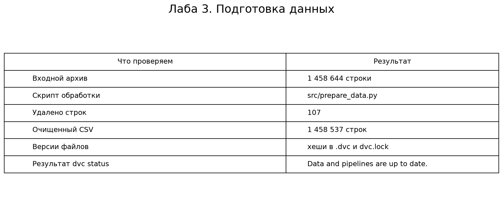

# Лабораторная работа №3

## Запуск

Для запуска нужен Python и Git LFS.

```bash
git lfs install
git clone https://github.com/Merhaba228/applied-ai-lab3.git
cd applied-ai-lab3
git lfs pull
pip install -r requirements.txt
python -m dvc repro
```

Скрипт читает исходный архив, выполняет очистку и сохраняет `data/processed/nyc_taxi_clean.csv`.

## Отчёт

Куликов Максим, группа 202М.

### 1. Что сделали

Взяли очистку из второй лабы и перенесли её в `src/prepare_data.py`.
Теперь её можно запустить без Jupyter. В скрипте две функции:
`clean_data` очищает таблицу, `main` читает и сохраняет файл.

### 2. Как проходит обработка

Сначала читаем архив NYC Taxi. Если есть пропуски, заполняем самым частым
значением столбца. Затем проверяем перевозчика, количество пассажиров,
координаты, флаг передачи и длительность поездки по правилам второй лабы.
Строки, которые не подходят, удаляем. Результат сохраняем в CSV.
Поездки дольше часа остаются, кроме значений свыше 24 часов.
Границы координат и длительности здесь приняты как правила нашей выборки,
а не как доказательство ошибки в каждой удалённой поездке.



Исходно было 1 458 644 строки. После очистки осталось 1 458 537.
Удалено 107 строк. Это тот же результат, что во второй лабе.
Картинка показывает результат выполненного запуска, это не скриншот терминала.

### 3. Зачем здесь DVC

В `dvc.yaml` записано, какую команду запускать и какие файлы ей нужны.
В `.dvc` и `dvc.lock` сохранены хеши исходного архива, кода и результата.
Если данные или скрипт изменятся, DVC сможет заметить это и повторить обработку.
Когда ничего не менялось, `dvc repro` пропускает уже готовый этап.

Проверка после выполнения:

```text
python -m dvc status
Data and pipelines are up to date.
```

### 4. Где хранятся большие файлы

Очищенный CSV и кэш DVC исключены из Git через `.gitignore`.
Архив доступен через Git LFS, чтобы другой человек мог скачать исходные данные.
В обычной истории Git хранится небольшой LFS-указатель.
Для совместимости этой учебной схемы в DVC включено `no_scm = true`:
DVC проверяет данные, но не управляет Git автоматически.
Отдельный DVC remote в этой работе не настроен.

### 5. Вывод

1. Обработка вынесена из ноутбука в отдельный скрипт.
2. DVC фиксирует входные данные, код и результат обработки.
3. Проект можно скачать и повторить очистку по командам выше.

## Почему архив есть в репозитории

По смыслу DVC тяжёлые данные должны храниться отдельно от Git. Но для учебной работы архив добавлен через Git LFS, чтобы проект можно было клонировать и запустить без отдельной настройки хранилища.

Архив не хранится как обычный текстовый файл Git. DVC-файл `data/raw/nyc-taxi-trip-duration.zip.dvc` и `dvc.lock` оставлены для демонстрации версионирования данных.

После настройки отдельного DVC-хранилища архив можно убрать из Git LFS и получать командой `dvc pull`.
